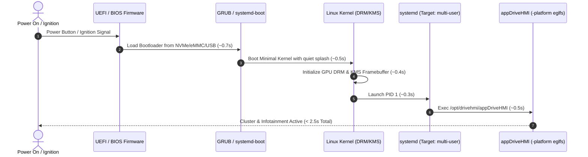

# DriveHMI: Bare-Metal & Dedicated Appliance Deployment Guide

This guide details how to package and run **DriveHMI** directly on target hardware with **no operating system pre-installed**, enabling an automotive-style, fast-booting dedicated appliance.

---

## 1. System Architecture: Direct DRM/KMS vs. Desktop OS

In an automotive cluster or dedicated kiosk, running a desktop environment (GNOME, KDE, X11, or complex Wayland compositors) adds unnecessary boot delays, memory overhead, and failure points. Instead, Qt interacts **directly with the Linux Kernel Mode Setting (KMS/DRM) subsystem and GPU drivers via the EGLFS plugin**.

```mermaid
graph TD
    subgraph DesktopOS ["Standard Desktop OS (Slow / Bloated)"]
        T_HW["Hardware (CPU / GPU / Display)"] --> T_KRN["Standard Linux Kernel + Drivers"]
        T_KRN --> T_SRV["Display Server (Xorg / Wayland Compositor)"]
        T_SRV --> T_DM["Display Manager (GDM / LightDM)"]
        T_DM --> T_DE["Desktop Environment (GNOME / KDE / XFCE)"]
        T_DE --> T_APP["Qt HMI Application (Windowed)"]
    end

    subgraph DedicatedAppliance ["Automotive Appliance (Direct DRM/KMS via EGLFS)"]
        A_HW["Target Hardware (x86_64 / ARM64)"] --> A_KRN["Minimal Linux Kernel + DRM Drivers"]
        A_KRN --> A_EGL["Qt 6 EGLFS Platform Plugin"]
        A_EGL --> A_APP["DriveHMI Application (Full-Screen Native)"]
    end

    style DedicatedAppliance fill:#0d1829,stroke:#00a8ff,stroke-width:2px;
    style DesktopOS fill:#1a1a1a,stroke:#666,stroke-width:1px;
```



---

## 2. Fast-Boot Lifecycle (< 3 Seconds)

When powered on, the firmware and bootloader hand off execution to a stripped-down kernel that launches your binary as the primary user-space payload.



---

## 3. End-to-End Image Creation Pipeline

```mermaid
flowchart TD
    subgraph BuildStage ["1. Application Compilation"]
        SRC["DriveHMI Source Code"] --> CMAKE["CMake + Ninja"]
        CMAKE --> BIN["appDriveHMI Binary"]
        BIN --> DEPLOY["linuxdeployqt / cqtdeployer"]
        DEPLOY --> BUNDLE["Self-Contained Root Bundle"]
    end

    subgraph PackagingStage ["2. Image Generation"]
        BUNDLE --> BUILDER["live-build / mkosi / Yocto"]
        KERNEL["Minimal Kernel + Mesa DRM Drivers"] --> BUILDER
        BUILDER --> TARGET_ISO["drivehmi_live.iso (Bootable USB)"]
        BUILDER --> TARGET_IMG["drivehmi_appliance.img (Raw Disk)"]
    end

    subgraph HardwareStage ["3. Target Execution"]
        TARGET_ISO --> USB["USB Flash Drive (Ventoy / Rufus / dd)"]
        TARGET_IMG --> FLASH["Direct Flashing to NVMe / eMMC / SSD"]
        USB --> BARE_METAL["Target Hardware (No Pre-installed OS)"]
        FLASH --> BARE_METAL
    end

    style BuildStage fill:#0a1220,stroke:#2563eb,stroke-width:1px;
    style PackagingStage fill:#0d1e38,stroke:#00a8ff,stroke-width:1px;
    style HardwareStage fill:#061b24,stroke:#10b981,stroke-width:1px;
```



---

## 4. Step-by-Step Implementation

### Step 1: Bundle DriveHMI with its Dependencies
Create a standalone directory with the binary, QML files, and Qt6 shared libraries:

```bash
# In your workspace:
cd /home/kakarot/Desktop/VSCode/IOT/qt/DriveHMI

# Ensure clean build
ninja -C build

# Create deployment directory
mkdir -p deploy/opt/drivehmi

# Copy binary and runtime files
cp build/appDriveHMI deploy/opt/drivehmi/
```

### Step 2: Systemd Autostart Service (Direct DRM/KMS)
Create a dedicated systemd service file (`drivehmi.service`) that runs the application without an X11 or Wayland server:

```ini
[Unit]
Description=DriveHMI Cluster and Infotainment
After=systemd-user-sessions.service plymouth-quit-wait.service
Conflicts=getty@tty1.service

[Service]
Type=simple
User=root
WorkingDirectory=/opt/drivehmi
Environment=QT_QPA_PLATFORM=eglfs
Environment=QT_QPA_EGLFS_KMS_ATOMIC=1
Environment=QT_LOGGING_RULES="qt.qpa.*=false"
ExecStart=/opt/drivehmi/appDriveHMI
Restart=always
RestartSec=1
StandardInput=tty
StandardOutput=journal
TTYPath=/dev/tty1

[Install]
WantedBy=multi-user.target
```

### Step 3: Build the Bootable ISO Using Debian `live-build`

Install `live-build`:
```bash
sudo apt-get update && sudo apt-get install -y live-build
```

Initialize minimal configuration:
```bash
mkdir -p hmi-live-build && cd hmi-live-build

lb config \
  --distribution bookworm \
  --archive-areas "main non-free-firmware" \
  --bootloader syslinux \
  --system live \
  --memtest none \
  --image-name "drivehmi-appliance" \
  --packages "linux-image-amd64 live-boot systemd systemd-sysv libgl1-mesa-dri libgl1 libegl1 libgbm1 libdrm2 libinput10 libxkbcommon0 fontconfig fonts-dejavu-core"
```

Overlay your application files and service:
```bash
# Create overlay directory
mkdir -p config/includes.chroot/opt/drivehmi
mkdir -p config/includes.chroot/etc/systemd/system/multi-user.target.wants/

# Copy binary and assets
cp -r /home/kakarot/Desktop/VSCode/IOT/qt/DriveHMI/build/appDriveHMI config/includes.chroot/opt/drivehmi/
cp /path/to/drivehmi.service config/includes.chroot/etc/systemd/system/
ln -s /etc/systemd/system/drivehmi.service config/includes.chroot/etc/systemd/system/multi-user.target.wants/drivehmi.service

# Build the ISO (run as root)
sudo lb build
```

The resulting `drivehmi-appliance.hybrid.iso` can be written to any USB drive:
```bash
sudo dd if=drivehmi-appliance.hybrid.iso of=/dev/sdX bs=4M status=progress conv=fsync
```

---

## 5. Architectural Comparison Matrix

| Approach | Boot Time | Storage Footprint | Complexity | Best Suited For |
| :--- | :--- | :--- | :--- | :--- |
| **Live Bootable ISO** | 8 – 12s | ~600 MB – 1.2 GB | Low | Demos, trade shows, testing on random PCs without installing |
| **Minimal Linux Appliance (EGLFS)** | 3 – 5s | ~400 MB – 800 MB | Medium | Industrial PCs, Intel NUCs, custom arcade/kiosks |
| **Yocto / Buildroot Embedded Linux** | 1 – 2.5s | < 120 MB | High | Automotive OEM production (Tesla, BMW, Renesas, NXP i.MX) |
| **Standard Desktop Linux (GNOME)** | 25 – 45s | 4 GB – 10 GB | Trivial | Desktop development only (Not for bare metal / kiosk) |

---

## 6. Automotive Production Best Practices

1. **Read-Only Root Filesystem (`OverlayFS`)**: Protect internal storage from corruption caused by sudden vehicle power cuts / ignition shutoff.
2. **Silent Boot (`quiet splash vt.global_cursor_default=0`)**: Hide kernel boot logs and flashing terminal cursors.
3. **Hardware Watchdog**: Configure Linux `/dev/watchdog` to automatically restart the application or reboot the system if the HMI ever hangs.
4. **Hardware Acceleration Verification**: Ensure the kernel module for your target GPU (`i915`, `amdgpu`, `nouveau`, or `panfrost`) is loaded early in the `initramfs`.
